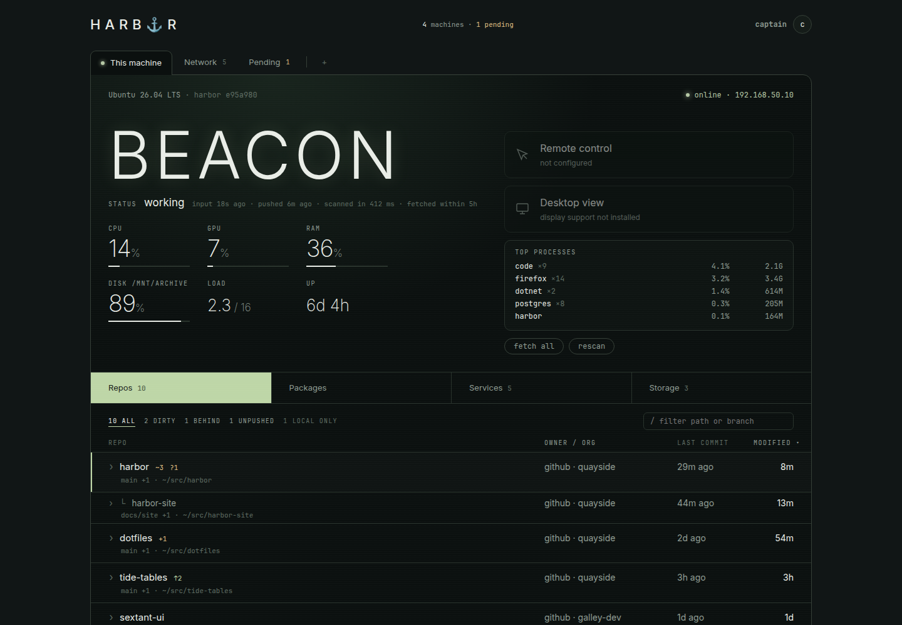

# harbor

Repos and releases across all my machines: a zoomed-out view of what exists where,
what's dirty or unpushed, and which services are up. Self-hosted, deterministic (no AI needed),
light by default, and tailnet-only.



- **Site:** <https://seanwilken.github.io/harbor/> (tour, architecture, roadmap)
- **Install:** [docs/INSTALL.md](docs/INSTALL.md) · **Contribute:** [CONTRIBUTING.md](CONTRIBUTING.md)
- **Overview** (what it tracks, integration points, open decisions): [docs/OVERVIEW.md](docs/OVERVIEW.md)

## Product direction and optional display support

Harbor is the machine/repository ledger, inventory and administration/control plane.
It installs and operates independently. Desktop viewing will be an optional capability
using reusable DisplayOverInternet packages, with no requirement to run that standalone
application. Experimental runtime packages and a synthetic consumer are available for integration
feedback; production adapters remain pending. Repository, fleet, ledger and admin work
can continue independently. See [the integration handoff](docs/DISPLAY_INTEGRATION.md)
for current building blocks, ownership, permissions and delivery gates.

## Architecture review note

Adopted 2026-11-12 (details at the end of the recommendation): 5-minute heartbeat, daily fetch and
manifest, refresh-on-open, writes only for changed rows, daily retention, cross-site protection.

Before expanding collection, jobs, display integration or edge deployment, read
[the lean architecture recommendation](docs/LEAN_ARCHITECTURE_RECOMMENDATION.md).
It proposes lower-frequency reconciliation, change/hash-based reporting,
bounded retention, GitHub-backed remote facts, on-demand freshness, and a future
Rust edge reporter for Pi/N100-class nodes. It is a review proposal, not an
implemented migration.

## Modes

One binary: `harbor [agent|hub|both|migrate] [--config <path>] [--ui <dir>]` (default `both`).

| mode | does | listens on |
|---|---|---|
| `agent` | scans repos + services, pushes to `agent.hub` | `listen` (loopback; `/api/snapshot` for debugging) |
| `hub` | stores pushes in Postgres, serves the UI and API | `listen` + this node's Tailscale addresses |
| `both` | hub, plus this machine's agent in-process (trusted, auto-approved) | as hub |
| `migrate` | applies `db/up/*.sql` and exits | — |

## Run the hub

```sh
deploy/install-pg.sh                 # podman quadlet harbor-pg; prints the connection string
cp harbor.example.json harbor.json   # set hub.database, hub.admins, roots, services
(cd ui && bun install && bun run build)
dotnet run --project src/Harbor      # both; http://127.0.0.1:7420 and http://<hub>:7420
```

harbor-pg is a user unit: it starts with your session. To have it start at boot,
run `sudo loginctl enable-linger $USER` once.

## Add a machine

Step-by-step for the hub, Windows and Linux/Pi: [docs/INSTALL.md](docs/INSTALL.md).

Use the lean agent, `harbor-agent`: a separate executable with no web server or database code.

1. Build it on any machine with the .NET SDK:
   `dotnet publish src/Harbor.Agent -c Release -r linux-arm64 -o out/arm64` (Raspberry Pi 64-bit;
   or `linux-x64`, `win-x64`). One self-contained file, about 22 MB, trimmed; nothing to install
   on the target except `git`.
2. A `harbor.json` with `machine`, `roots`, `services` and `"agent": { "hub": "http://<hub>:7420" }`.
3. Run it as a service: `deploy/harbor-agent.service` (systemd user unit; instructions inside). Or
   by hand: `harbor-agent run --config harbor.json`.
4. Pair it: in the UI's **Pending** tab, "pair a device" shows a one-time code (10 minutes, one
   use). On the machine: `harbor-agent pair 7KQ4-M2XP --hub http://<hub>:7420`. The running agent
   sends it with its next push and the hub approves that machine at once (audited as approved by
   whoever created the code). Without a code the machine waits as **pending** for approval in the UI.
5. `harbor-agent status` says whether this machine is tethered (exit 0), waiting (1) or not (2),
   from a status file the agent rewrites each push (`~/.local/state/harbor/`,
   `%LOCALAPPDATA%\harbor\` on Windows). Handy in a login banner.

**Tray (desktops):** `harbor-tray` shows the tether light (green tethered, amber waiting, red not,
grey nothing here), the agent's state, the fleet on the hub machine, and menu items "Open harbor",
"Pair a device…" (hub) and "Pair with hub…" (agents). It reads the agent's status file and the hub's
loopback API; it does not run the agent. Build: `dotnet publish src/Harbor.Tray -c Release -r
linux-x64` (or `win-x64`); start at login with `deploy/harbor-tray.desktop`. Headless machines use
`harbor-agent status` instead (an LED indicator for a Pi is planned).

`harbor-agent snapshot` and `harbor-agent manifest` print what it would send, for checking a new
machine without a hub. The agent needs no inbound port, no certificate and no Tailscale Serve: it
connects out to the hub's tailnet address. Measured on x86-64 (2026-11-12): about 37 MB private
memory plus 25 MB of the mapped program, 12 threads, about 0.1 s CPU per minute between rescans.

The full `harbor` binary (`harbor agent`) still works as an agent, but carries the hub (113 MB).
Don't add `IncludeNativeLibrariesForSelfExtract` to win-x64 builds: that build exits before `main`
under wine, and nothing needs it.

## Identity and access

- Agents push to the hub's Tailscale address. The hub asks tailscaled's LocalAPI WhoIs who is
  calling and records the node's StableID. A machine is (StableID, `machine` name), so two agents
  on one node enrol separately. Pushes over loopback are refused because the sender can't be identified.
- Every request is checked: loopback passes, tailnet callers pass if WhoIs knows them, anything else
  gets a 403. The hub never binds `0.0.0.0`, so it isn't reachable on the LAN.
- Roles. **Admin**: loopback, or a login in `hub.admins`; sees everything and can approve/reject,
  queue jobs, hide repos and rescan. **Viewer**: a login in `hub.viewers` (`"*"` = any identified
  tailnet user); read-only, with process lists, MAC and LAN addresses, gateways, git identities,
  changed file names, service details, job output and machine logins removed. Anyone else gets a 403
  for the UI and API (agents can still push: enrollment has its own approval). Nothing configured
  means admins only. Every device logged in as you counts as you.
- Admin actions (approve, reject, job requested, repo hidden/unhidden) are `event` rows with an
  `actor` (the login, or `local`).
- Agents strip credentials from remote URLs (`https://token@host/x` → `https://host/x`) before
  anything leaves the machine.
- The snap's tailscaled socket is `/var/snap/tailscale/common/socket/tailscaled.sock`; `/run/tailscale/`
  is tried next.

## Storage

PostgreSQL 18 in podman. `db/up/NNNN_*.sql` are applied by [grate](https://github.com/grate-devs/grate)
at hub startup. grate refuses to run if an applied script was edited, so add a new file instead.
After adding one, run `db/regen.sh` to regenerate the SqlHydra types in `src/Harbor.Db/HarborDb.fs`
(that project has nullness off because the generated code needs it; Harbor keeps it on).

Tables: `machine`, `snapshot_latest` (JSONB payload), `repo` and `service` (rows replaced each push),
`git_commit` (deduplicated by remote + sha) and an append-only `event` table (repo added/removed,
commit_seen, dirty/clean, ahead_behind, branch_changed, service_up/down, machine enrolled/approved).
Ingest is serialized so event ids commit in order (the slice 3 feed cursor).

## Agent behaviour

Pushes every `pushSeconds` (default 300) and right after each rescan (`rescanSeconds`, default 600);
opening a machine in the UI asks for an immediate rescan and push. While the hub is unreachable it backs off
(5 s doubling to 5 min, with jitter) and always sends the newest snapshot. Recent commits (30 days,
at most 100) are sent for repos whose HEAD the hub hasn't stored yet. The UI marks a machine stale
after it has missed about 3 pushes and keeps showing its last snapshot.

Each snapshot also carries, read fresh at push time (anything unavailable is left out):

| | Linux | Windows |
| --- | --- | --- |
| CPU % (average since the last push), memory | `/proc/stat`, `/proc/meminfo` | `GetSystemTimes`, `GlobalMemoryStatusEx` |
| load average | `/proc/loadavg` | — |
| GPU % and VRAM | `nvidia-smi`, or AMD's sysfs `gpu_busy_percent` | `nvidia-smi` |
| input idle time (working / idle at 5 min) | GNOME's IdleMonitor over the session D-Bus | `GetLastInputInfo` (interactive session only) |
| disks, uptime, top processes (grouped by name) | .NET | .NET |
| interfaces, gateway and its MAC (tells networks apart) | .NET + `/proc/net/arp` | .NET + `arp -a` |
| local branches per repo | `git for-each-ref refs/heads` | same |

Process names are cut to the program name: Linux can report a whole rewritten command line, which
can include session tokens.

## Manifests and recaps

Each agent builds a **manifest** after its first scan and every `manifestHours` (default 6): OS and
kernel, packages per manager (dpkg with apt's already-known upgrades, snap, flatpak; nothing is
refreshed or downloaded), and where each repo is and what it tracks. Content is sorted and hashed; an
approved agent sends it only when the hash differs from what the hub holds, and the hub stores a new
row only on change, so `manifest` rows are each machine's change history.

- UI: **Packages** on a machine (managers, search, upgradable, history with "changes"), **compare**
  in Network (any two machines' latest manifests), **recap** in Network.
- API: `/api/machines/{id}/manifests`, `/api/manifests/{id}` (`?format=md` exports Markdown),
  `/api/manifests/{a}/diff/{b}`, `/api/recap?days=7` (`&format=md`), `/api/recaps`, `/api/recaps/{id}`.
  Package contents, diffs and the machine/drift parts of recaps are admin-only.
- **Recap**: repos behind upstream for `behindDays`+ (git's date of the oldest missing upstream
  commit), uncommitted or unpushed for `dirtyDays`+, neglected (no commits or changes for
  `neglectedDays`+), per-machine package changes and pending upgrades, and version drift between
  machines. The hub stores one per week, ending 00:00 on `weekday`:
  `"hub": { "recap": { "weekday": "monday", "behindDays": 7, "dirtyDays": 7, "neglectedDays": 30 } }`.
- Not yet collected: Windows (winget), Homebrew, and language-level tools (npm -g, pipx, dotnet tools).

## Hub link

Each agent keeps one WebSocket open to the hub (`/api/agent/connect`, on the hub's tailnet
address, identified by WhoIs like pushes). Agents only connect out; nothing listens on them. The
link carries live messages only: `hello` (agent), `welcome` and `wake` (hub). A queued job wakes the
agent, which pushes at once and gets the job in the reply, so jobs reach remote machines in under a
second. Results and retries still travel by push and reply, so nothing durable is replayed from the
socket after a reconnect. Without the link (older hub, network trouble) pushes carry on with their
timer. Message format and rules are in `src/Harbor/AgentLink.fs`; display signaling will be its own
message family on the same socket.

## HTTPS for browsers (Tailscale Serve)

Set `hub.serveListen` to a loopback URL, e.g. `"http://127.0.0.1:7425"`, then point Serve at it once:

    sudo tailscale serve --bg --https=7443 http://127.0.0.1:7425

Browsers then use `https://<node>.<tailnet>.ts.net:7443/`. On that listener only, the caller is the
`Tailscale-User-Login` header Serve sets (Serve replaces any copy a client sends); requests without
one (tagged devices) are refused, and pushes and agent links are refused there. Never point Serve
or any proxy at `7420`: loopback there is trusted as admin. Any local process can reach `7425`
with a forged header, but local processes are already admin through `7420`.

## Repos, fetching and jobs

- Discovery walks each root to `maxDepth`, skipping `ignore` names and (with `skipHidden`) dot-folders;
  any folder with `.git` is a repo and isn't descended into. Linked worktrees are recognised and shown
  under their main repo. Repos you don't care about can be hidden from the UI (stored on the hub).
- ahead/behind is relative to the last `git fetch`. Agents fetch every repo with a remote after the first
  scan and every `fetchMinutes`; "fetched" comes from `FETCH_HEAD`, so your own fetches count too.
  Fetch never touches the working tree or branches. Remotes that need a password fail (prompts are off)
  and show "fetch failed".
- On-demand work goes through a small job queue: the UI (loopback or `hub.admins`) queues a job, the
  hub hands it to the agent in the reply to its next push, and the result comes back in the push after.
  An agent only runs job kinds listed in its own `agent.allow` (default `["fetch"]`). Remote machines
  pick a job up within `pushSeconds`; the hub's own agent is woken at once.

## UI

Tabs across the top: **This machine** (the hub's own agent), **Network** (every machine as a card, a
map of how they reach the hub, or **repos** cloned on 2+ machines), **Pending** (approve / reject), then
machines pinned with ☆ (kept per browser). Each machine's card holds its figures, access tiles and
Repos / Applications / Services / Storage, which drive the table below it. Keys: `h`/`l` tabs, `j`/`k`
rows, `f` fetch the selected repo, `F` fetch all, `r` rescan, `/` filter. Deep links: `#this`,
`#network`, `#network/map`, `#network/repos`, `#pending`, `#m/<id>`. Theme: DisplayOverInternet's
sage-on-black (`ui/src/styles.css`); the layout reference is `docs/mockups/machine-hero.html`.
UI dev with hot reload: `cd ui && bun run dev` (port 7421, proxies `/api` to 7420).

## Layout

- `src/Harbor`: `GitParse` (pure) ← `Git` ← `Discovery` ← `Inventory` (scan + recent commits);
  `Services`; `Config`; `Migrations` (grate); `Tailscale` (LocalAPI client); `Enrol` (pure access/
  enrolment decisions); `Events` (pure snapshot diff); `Storage` (SqlHydra); `Agent` (push loop);
  `Hub` (guard + API); `Program` (modes).
- `src/Harbor.Db`: generated SqlHydra types. `db/`: migrations, `regen.sh`. `deploy/`: Postgres quadlet.
- Tests: `dotnet test` (parsers, remote keys, event diff, WhoIs parsing, enrolment decisions).
